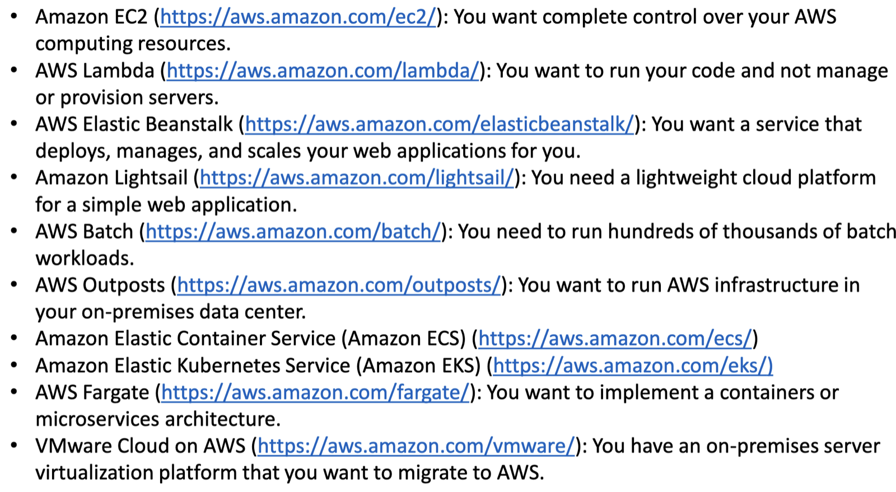

cloud service models
iaas
provides u with servers, storage, networking, etc and u have to manage the os and application
aws ec2
azure virtual machine

paas
u have to deploy ur application, they manage the os/servers/runtime
google cloud app engine
heroku

saas
they provide u full ready to use service
google docs
salesforce

3 ways to interact with aws
aws management console
command line interface(aws cli)
sdk’s

route 53 is an aws dns service. it routes users to infrastructure both inside and outside aws

cloudFront is a fast content delivery network service

aws rds is amazon’s relational database service that helps in setting up relational database servers in the cloud

aws cloudFormation is a infrastructure as code(IaC) service that helps u automatic the process of creating/defining services using a yaml or json template instead of explicitly defining them manually
reduces manual work
reduces error
automates the whole process
make deployment repeatable

as the name suggest
aws autoscaling
aws ELB(elastic load balancing)
aws sns(simple notification service)

aws lambda is a serverless compute service that lets u run the code without provisioning or managing the servers.

aws sqs(simple queue service) that lets diff application/services communicate asynchronously by sending messages through a queue

eleastic beanstalk helps for deploying and scaling web applications, u just upload ur code, and the service handle the deployment

ebs(elastic block store) helps in providing persistent block storage for services like amazon ec2 instances

amazon glacier is a low cost storage service for data archiving and long term backup

aws kms(key management service)

aws cognito enables user sign up, sign in, and in access control to web and mobile apps easily

aws inspector is an automated sercuity assessment service

IaC is the management of infrastructure(networks, virtual machines, load balancers, etc.) in a descriptive model, using tools like cloudFormation and terraform

ecs is a highly scalable container orchestration service that supports docker containers

aws fargate is a serverless compute engine for containers that works with both ecs and eks, eliminating the need to provision and manager servers

aws cloud9 is a cloud based ide

aws codeStar is a unified user interface that makes it easy to develop, build and deploy applications on aws quickly

to ensure high availability use elastic load balancing, auto scaling, and design fault tolerance architectures

to monitor aws resoruces
use cloudwatch for logs and metrics, cloudTrail for auditing, and aws config for configuration tracking and compliance

CI/CD in aws
Use CodePipeline for automation, CodeBuild for testing, and CodeDeploy for deploying updates. Integrate with GitHub or AWS CodeCommit.

to scale webApp
Use EC2 Auto Scaling, distribute traffic with ELB, cache with CloudFront and ElastiCache, and scale databases with RDS/Aurora.
