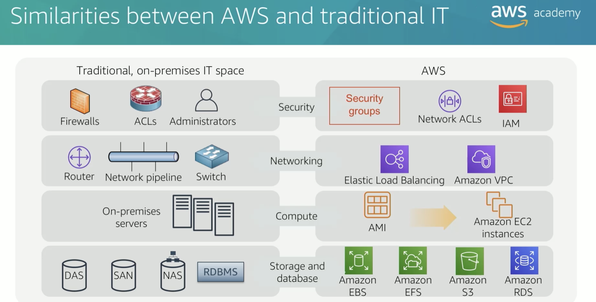
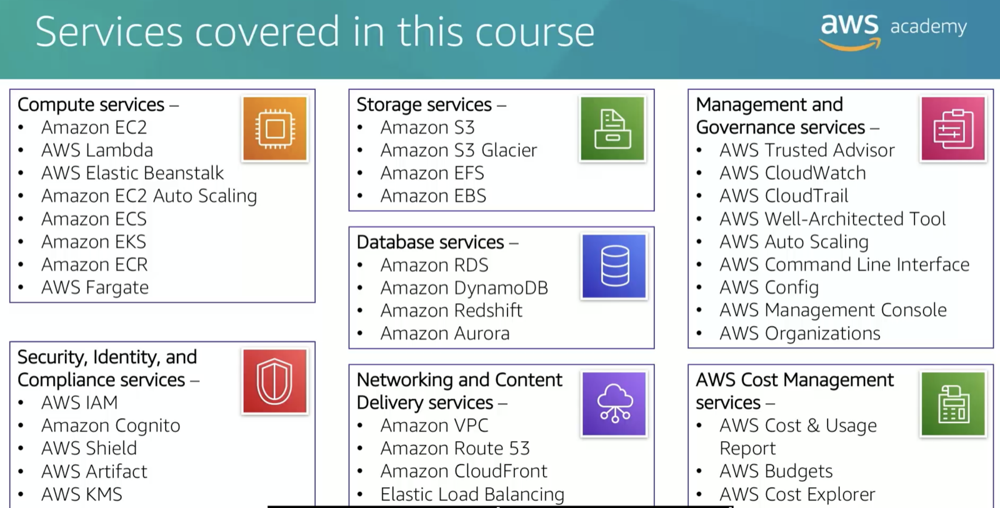

cloud computing is the on demand delivery of compute power, database, storage, applications, and other IT resources via the internet with pay-as-you-go pricing.

lets u think cloud computing, infrastructure as a software instead of hardware
make it flexible, quickly, easily, and cost effectively manage ur service.
iaas
basic building blocks of cloud IT, that provides u access to computers whether they virtual or dedicated, and provide storage space and other IT resources.

paas
hardware and operating system

saas
end user application, provides u the complete product that is run and maintain by the service provider

cloud computing deployment models

- cloud
- hybrid
- on-premises

web service
its a piece of software that makes itself available over the internet and uses a standardized format-such as xml or json for the request and the response of an application programming interface(API) interaction.

3 ways to interact with aws

- aws management console
- command line interface(aws cli)
- software development kits(sdks)

aws caf perspectives

- business
- people
- governance
- platform
- security
- operations
