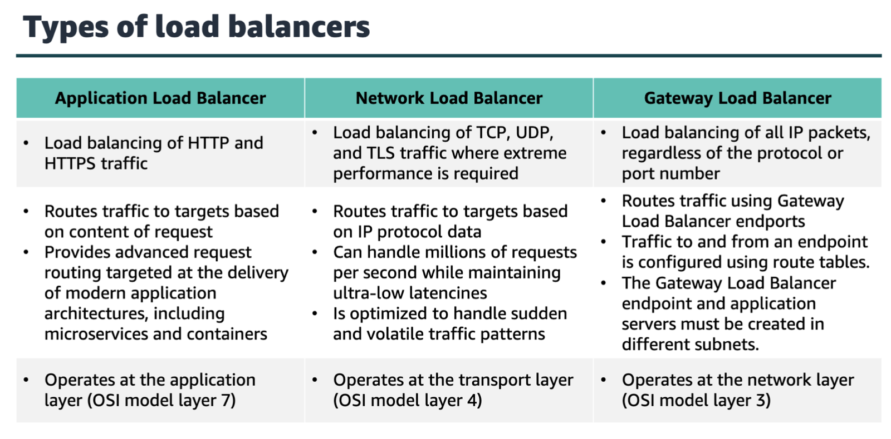
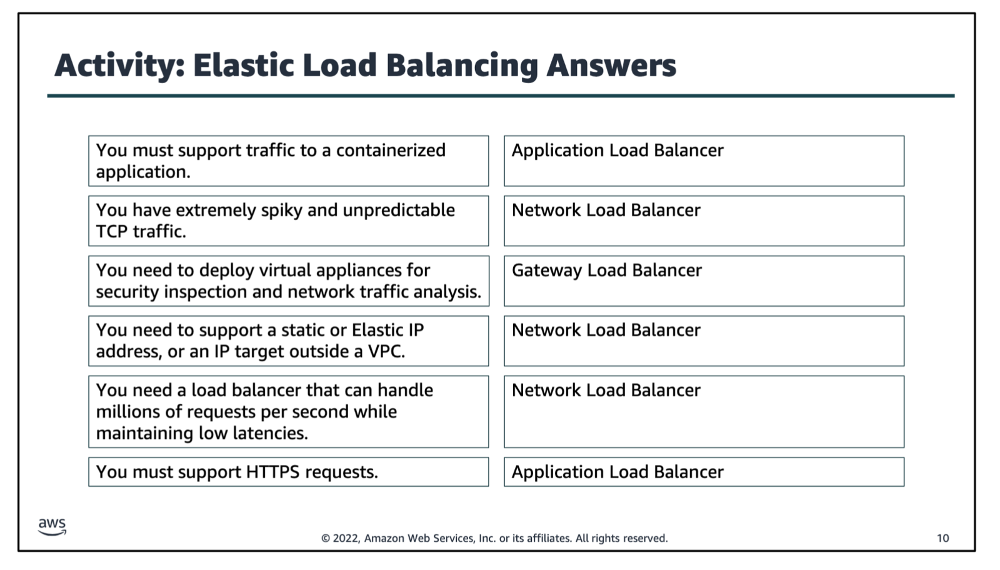
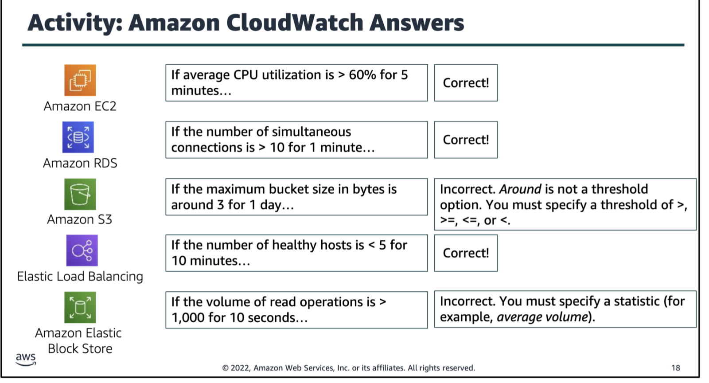
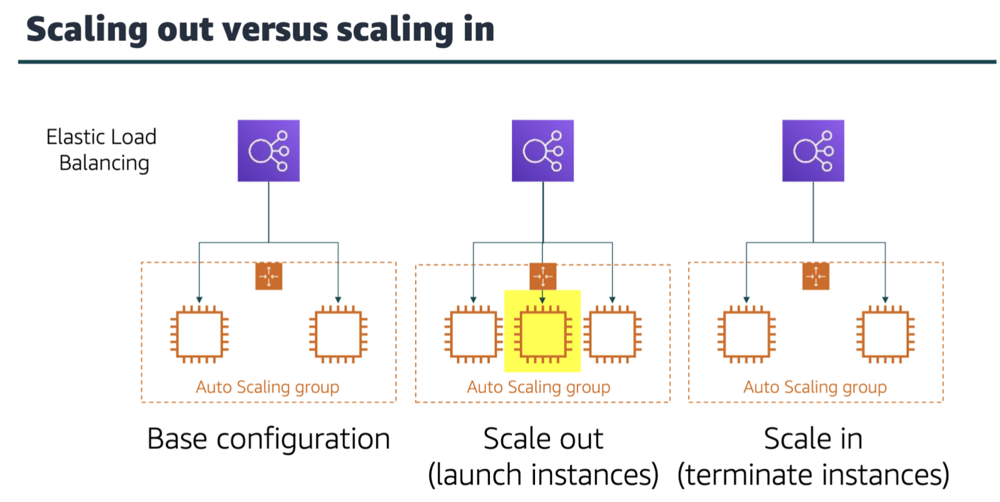
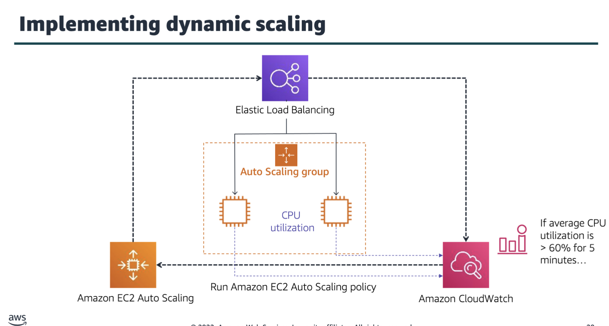
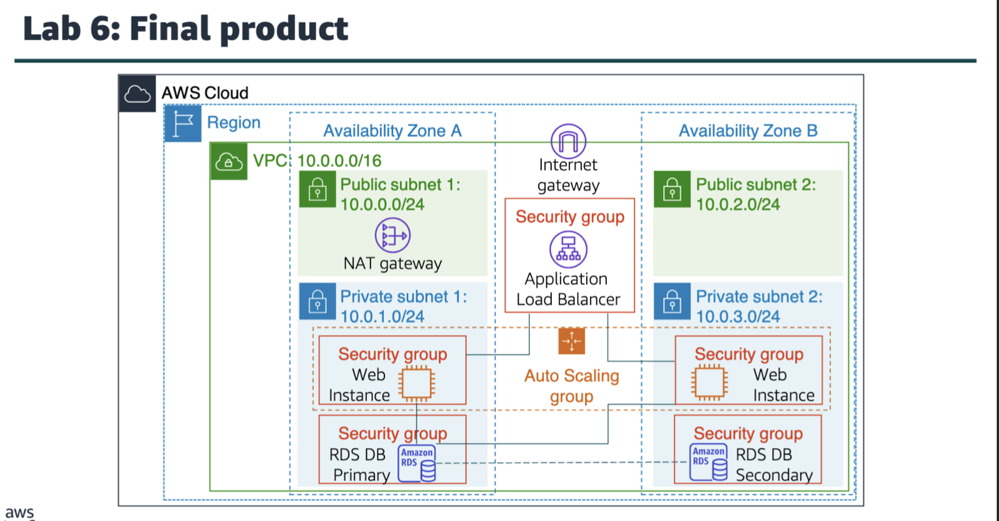

fleet in aws generally refers to a grp of instances or resources managed together, actual definitions may vary according to the services
ec2 fleet, spot fleet, etc
elastic load balancing
distributes incoming application or network traffic across multiple targets in a single availability zone or across multiple availability zones.

amazon cloudwatch
you can use CloudWatch to collect and track metrics, which are variables that you can measure for your resources and applications.

amazon ec2 auto scaling

an auto scaling grp is a collection of ex2 instances that are treated as a logical grouping for the purpose of automatic scaling and management.

launching instances is referred to as scaling out, and terminating instances is referred to as scaling in.

dynamic scaling

amazon ec2 auto scaling responds to changing conditions by adding or terminating instance, launches instances from an ami, and enforces a minimum number of running amazon ec2 instances.
u configure the load balancer to accept incoming traffic by specifying one or more listeners.
u specify the ami, instance types, and ebs vol when u create an auto scaling launch config.
when load balancer detects an unhealthy target, it stops routing traffic to that target and sends it to a healthy target. it then resumes routing traffic to that target when it detects that the target is healthy again.
gateway load balancer is also called classic load balancer.
