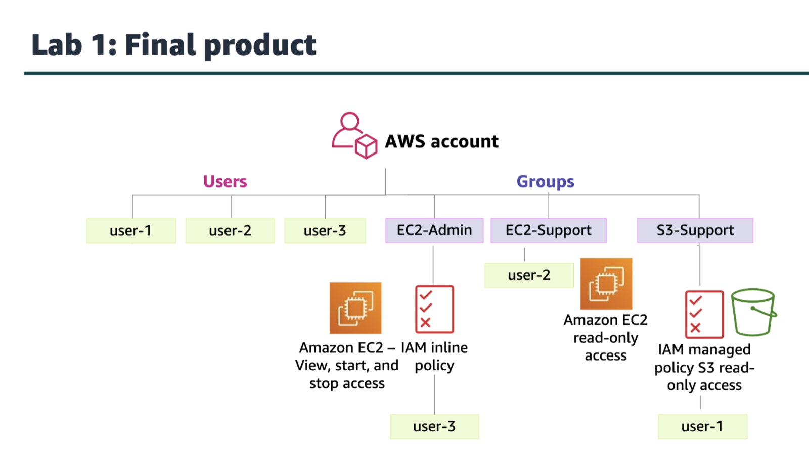

the customer is responsible for performing necessary security config and management tasks.

iam policies
identity based and resource based

identity policies can be subdivided into two policies
Managed policies
Standalone identity-based policies that you can attach to multiple users,
groups, and roles in your AWS account
Inline policies
Policies that you create and manage, and that are embedded directly into a
single user group or role.

resource based policies are json policy doc that u attach to a resource.
an explicit deny statement takes precedence over an allow statement.

by default the permissions are set to deny, this is called implicit deny.

imp char of iam groups:
a grp can contain many users.
a grp cannot be nested.
there is no default grp that automatically includes all users in the aws acc.

iam policies are constructed with json and define permissions
iam policies can be attached to any iam entity
iam entities are:
iam user provides a way for a person, application, or service to authenticate to aws.
iam grp is a simple way to attach the same policies to multiple users.
iam role can have permissions policies attached to it, and can be used to delegate temporary access to users or applications.

the basic structure of the statements in an iam policy is;
effect says whether to allow or deny the permissions
action specifies the api calls that can be made against an aws service
resource defines the scope of entities covered by the policy rule

lab1

aws organizations security features:
group aws acc into organizational units
integration and support for iam
user service control policies

aws key management service(aws kms)
create and manage encryption keys
integrates with aws cloudtrail to log all key usage
uses hardware security modules(HSMs) that are validated by federal information processing standards(FIPS) 140-2 to protect keys

customer master keys(CMKs) are used to control access to date encryption keys that encrypt and decrypt ur data.

aws security compliance programs provide info abt the policies, processes, and controls that are established and operated by aws.

aws config is used to assess, audit, and evaluate the configurations of aws resources.

aws artifact
is a resource for compliance related information.

keys takeaways from this course: cloudtrail, cognito(uses SAML 2.0), aws shield
data at rest refers to data that is physically stored on disk or on tape.

security in cloud means
encryption of data at rest and data in transit
security grp config

aws responsibility under shared responsibility model
maintaining physical hardware

changing the support plan can only be done by the root user

best practice for the aws acc root user is to delete the access keys of the aws acc root user

iam is based on the rule of least privilege.
