ica is independent computing architecture, developed by citrix systems to facilitate efficient data transfer between a server and a client.

vpc
selection of ip addr range
creation of subnets
config of route tables and network gateways

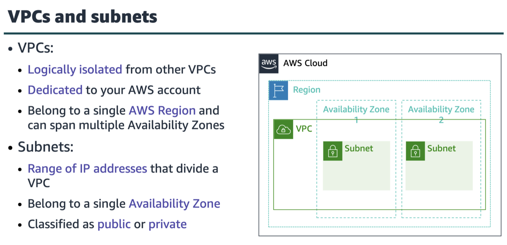

a vpc belongs to one Region and requires a CIDR block.

public subnets have direct access to the internet but private subnets do not.

out of 256 addr there are 5 addr that are reserved
network address 10.0.0.0
vpc local router(internal communications) 10.0.0.1
dns resolution 10.0.0.2
future use 10.0.0.3
network broadcast addr 10.0.0.255

public ip address types
public ipv4 addr
manually assigned through an elastic ip addr
automatically assigned through the auto-assign public ip addr settings at the subnet lvl

elastic ip addr
associated with an aws acc
can be allocated and remapped anytime
additional cost might apply

elastic network interface
it is a virtual network interface:
attach to a instance
detach from the instance, and attach to antoehr instance to redirect network traffic
its attributes follow when it is reattached to a new instance
each instance in ur vpc has a default network interface

public subnet
it has a route to the internet via an internet gateway
direct access to the internet via internet gateway

private subnet
it does not have a direct route to the internet
no direct access to the internet; can connect to the nat gateway for outbound traffic

internet gateway
bidirectional traffic between a vpc and the internet, enabling both inbound and outbound connections for public resources.

nat gateway
it allows instances in private subnets to access the internet(outbound traffic only) but prevents inbound connections from the internet, providing a security layer.
—it is a fully managed, highly available aws service that provides outbound internet access for private subnets, simplifying management and scaling automatically.

nat instance
nat instance in an amazon ec2 instance that acts as a gateway for instances in a private subnet to access the internet.
—nat instance is an ec2 instance that u manually configure, scale, and maintain to perform the same function, offering more control and potential cost savings for certain workloads but requiring more administrative effort.

internet gateway
it is a vpc component that allows communication between instances in ur vpc and the internet.

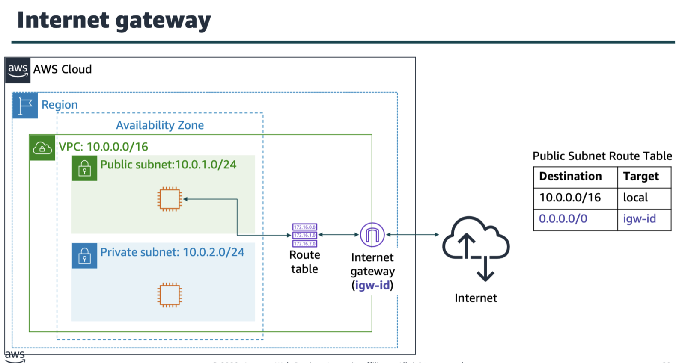

nat
it enables instances in a private subnet to connect to the internet or other aws services, but prevents the internet from initiating a connection with those instances.

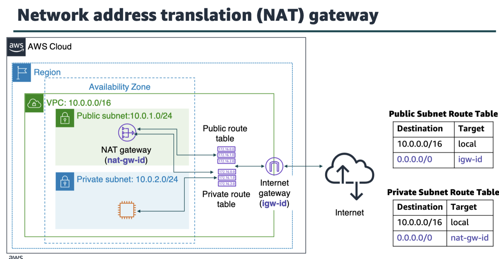

vpc sharing enables customers to share subnets with other aws acc in the same organization in aws organizations.

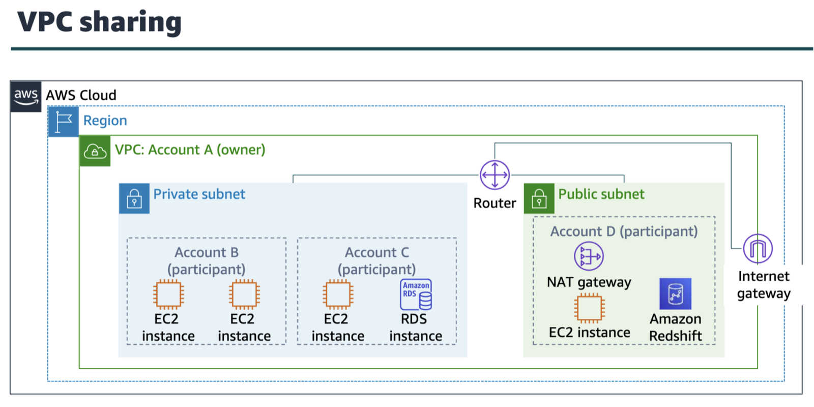

vpc peering connection is a networking connection between two vpcs that enables u to route traffic between them privately.
restrictions:
ip spaces cannot overlap
transitive peering is not supported
u can only have one peering resource between the same two vpcs

transitive peering is the ability for two networks to communicate indirectly through a central network, which is not possible with basic peering connections.
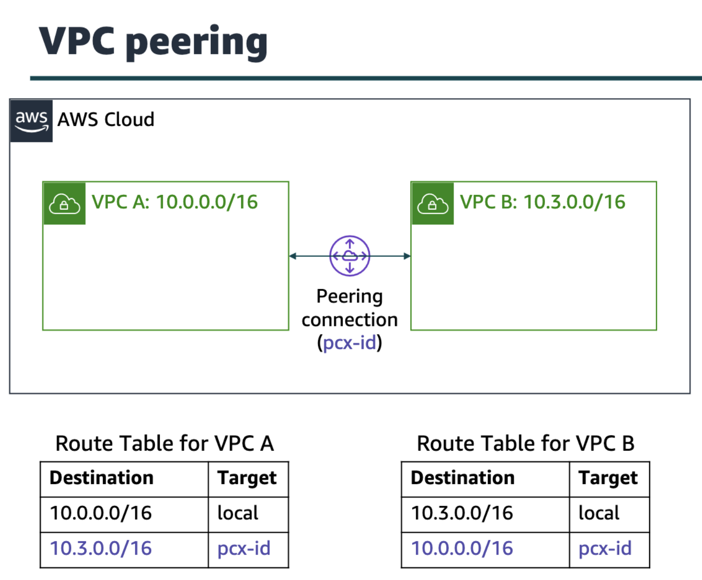

to connect vpc to ur remote network(that is, create a vpn connection)
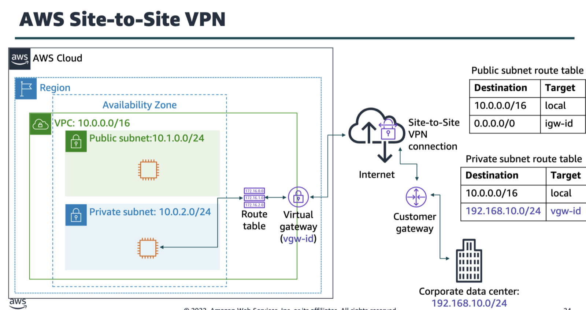

to improve the network performance we have aws direct connect, or DX; which lets u establish a connection between ur network and one of the DX locations in case if the data center is located far away from ur aws region. DX uses 802.1q vlans.
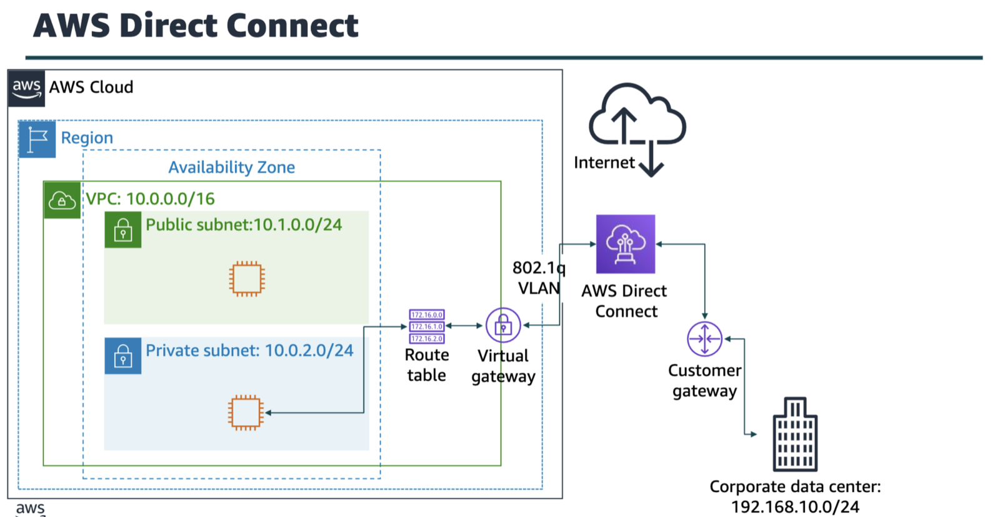

vpc endpoints
two types of endpoints: interface and gateway
A
VPC endpoint is a virtual device that enables you to privately connect your VPC to supported AWS services and VPC endpoint services that are powered by AWS PrivateLink. Connection to these services does not require an internet gateway, NAT device, VPN connection, or AWS Direct Connect connection.
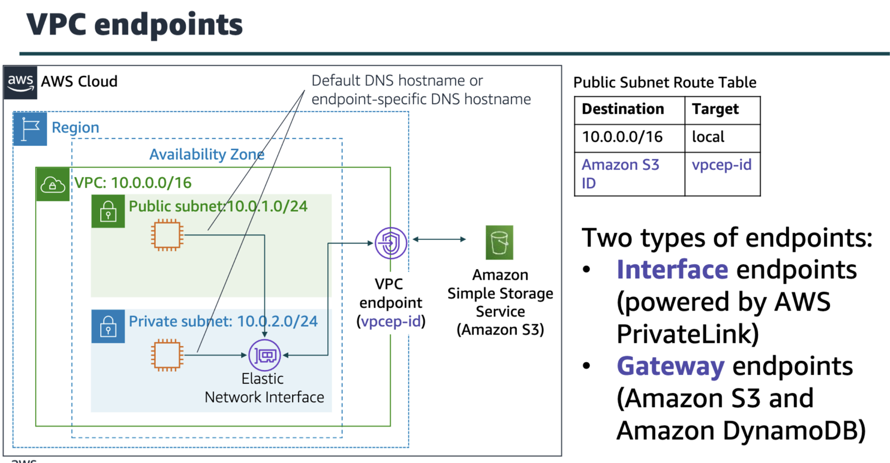

aws transit gateway
You can configure your VPCs in several ways, and take advantage of numerous connectivity options and gateways. These options and gateways include AWS Direct Connect (via DX gateways), NAT gateways, internet gateways, VPC peering, etc

but the most efficient sol’n would be aws transit gateway, u only need to create and manage a single connection from the central gateway into each vpc, on premises data center, or remote office across ur network.\\
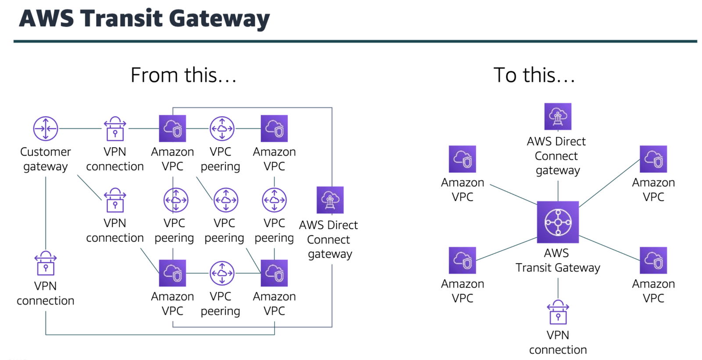

general diagram
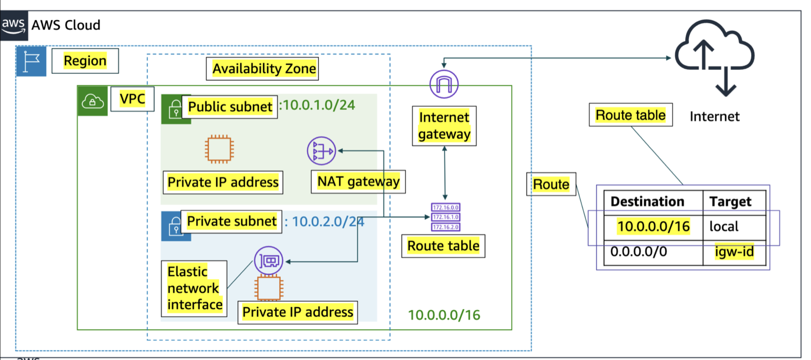

vpc security: under this we have the following firewall options to protect ur data
security grps and network access control lists(network ACLs)

security grp
it acts as a virtual firewall for ur instance, and it controls inbound and outbound traffic. Subnet grps act at the instance lvl, not the subnet lvl.
default security grps deny all inbound traffic and allow all outbound traffic.
note: responses to allowed inbound traffic are allowed to flow out, regardless of outbound rules.

network ACLs
it acts at the subnet lvl
it acts as an optional layer for ur amazon vpc.
similar to security grps
default network acls allow all inbound and outbound ipv4 traffic
they are stateless; which means that no info abt a request is maintained after a request is processed.
note: if u dont associate a network acl to a subnet it will automatically with the default network acl.

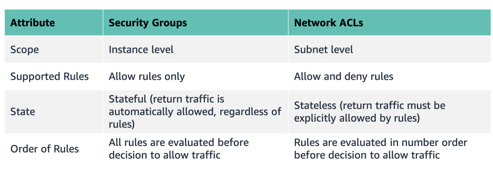

lab2
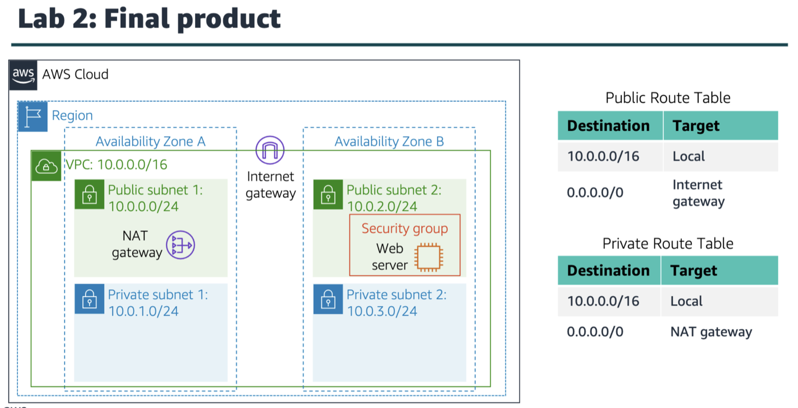

amazon route s3

- simple routing
- weighted round robin routing
- latency routing
- geolocation routing
- geoproximity routing
- failover routing
- multivalue answer routing

benefits

- latency based routing to the region
- load balancing routing to the availability zone

do not the following when the multi-tiered web application goes down, create two records: primary and secondary
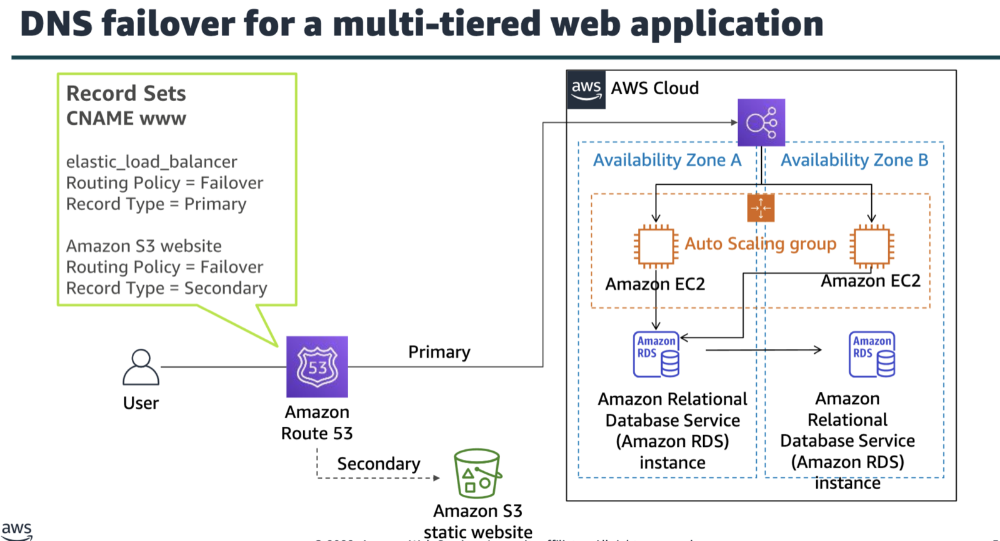

amazon route53 is a highly available and scalable cloud dns web service that translates domain names into numeric ip addr.

content delivery network(CDN)

- is a globally distributed system of caching servers
- caches copies of commonly requested files(static content)
- delivers a local copy of the requested content from a nearby cache edge or pop(point of presence; physical location where networks connect)
- accelerates delivery of dynamic content
- improves application performance and scaling

amazon cloudfront

- fast, global, and secure cdn service
- global network of edge locations and regional edge caches
- self service model
- pay as you go pricing

amazon cloudfront infrastructure
edge locations
multiple edge locations
regional edge caches

the maximum size ip addr range u can have in a vpc is /16
a network acl is an optional security control that can be applied at the subnet layer of a vpc
when u create a vpc, a route table is created by default. u must manually create subnets and an internet gateway.
a security grp acts as a virtual firewall for ur instance to control inbound and outbound traffic.
