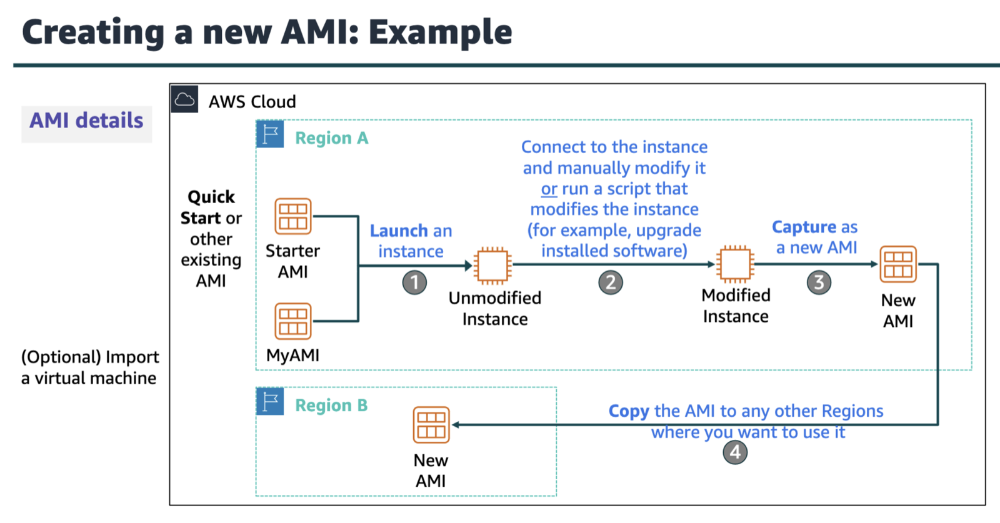
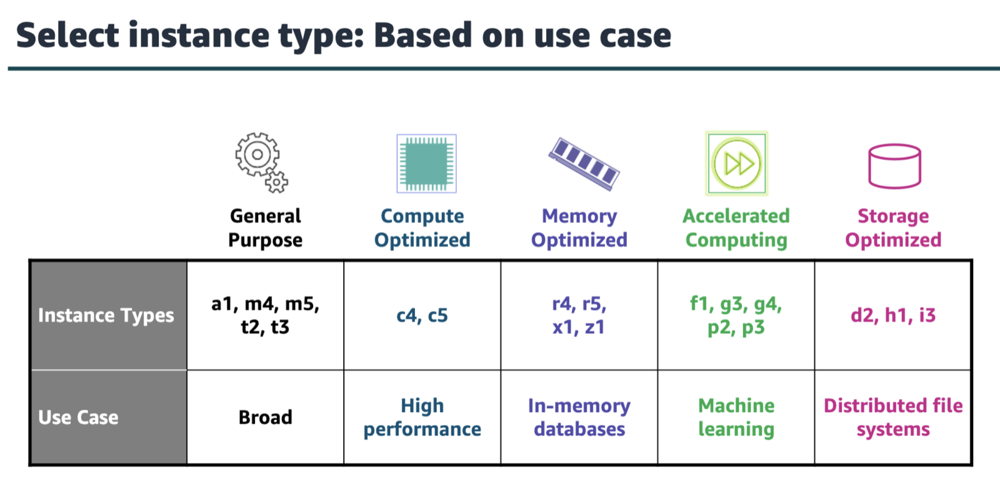
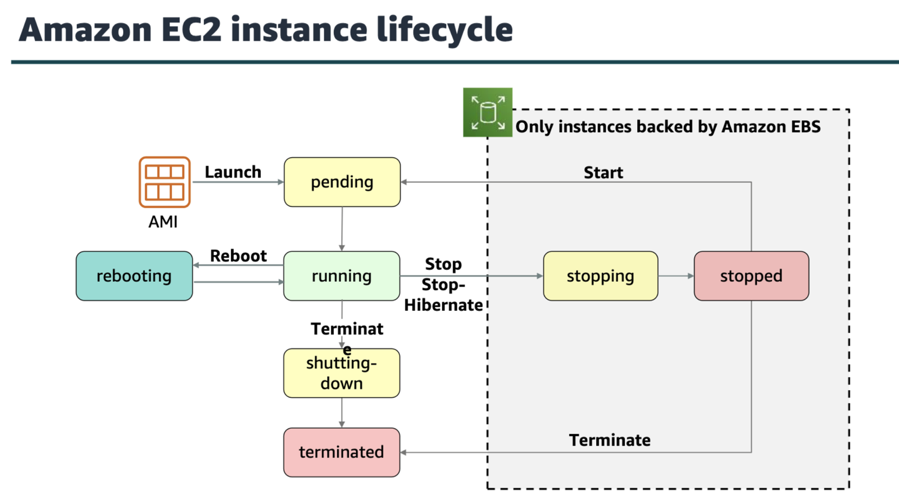
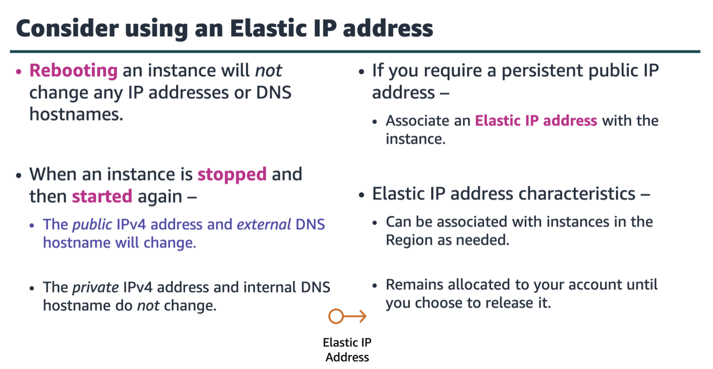
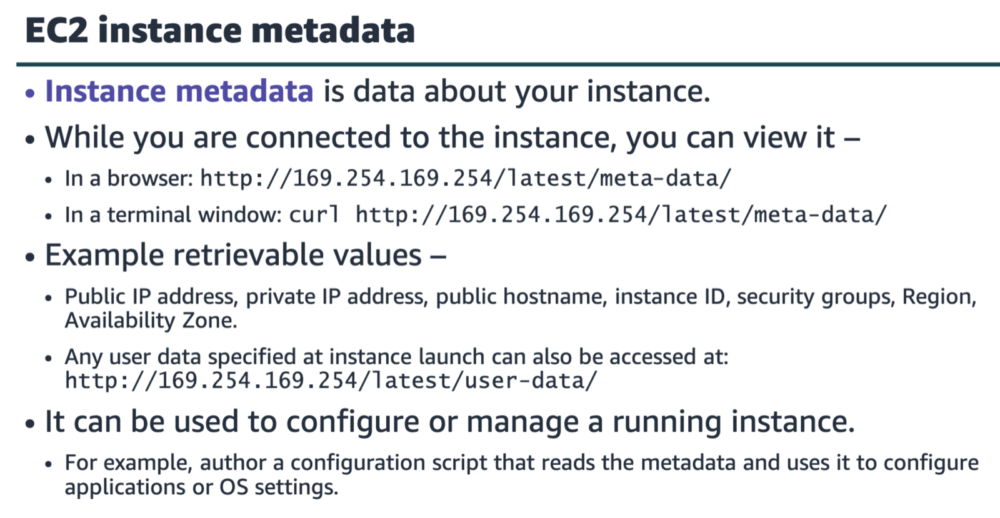
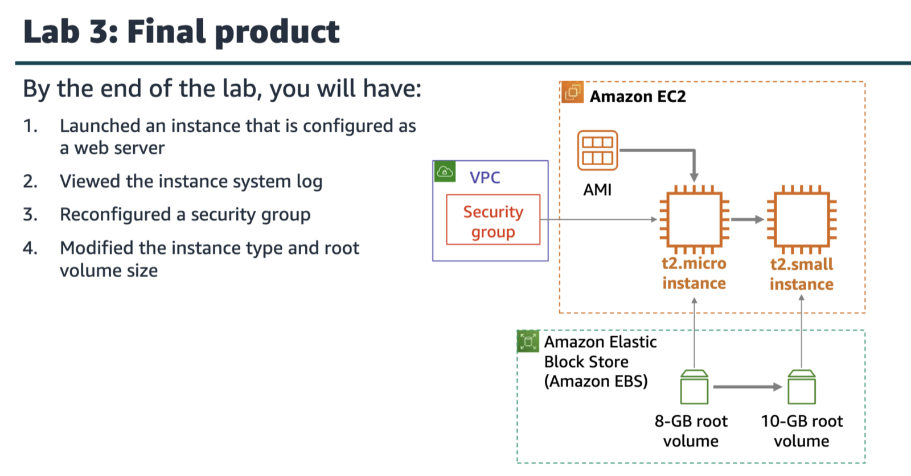
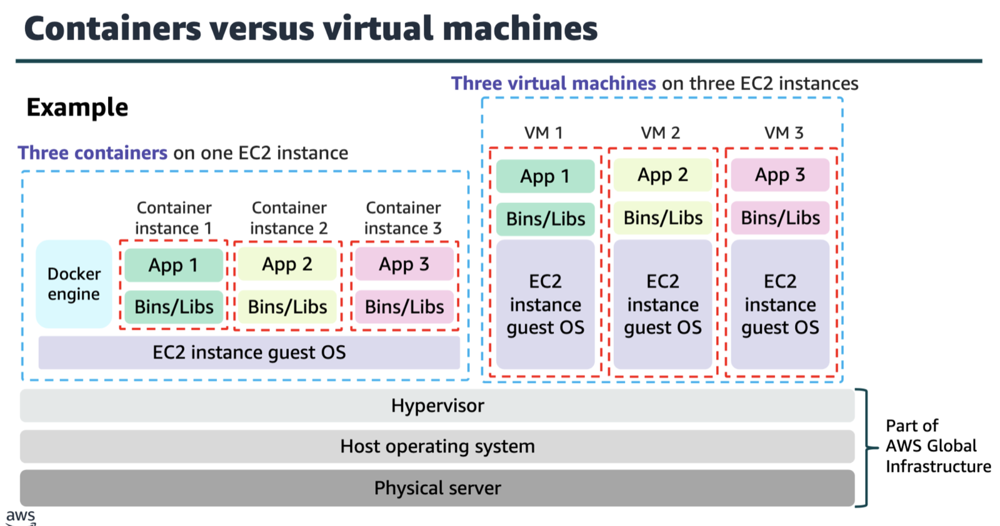
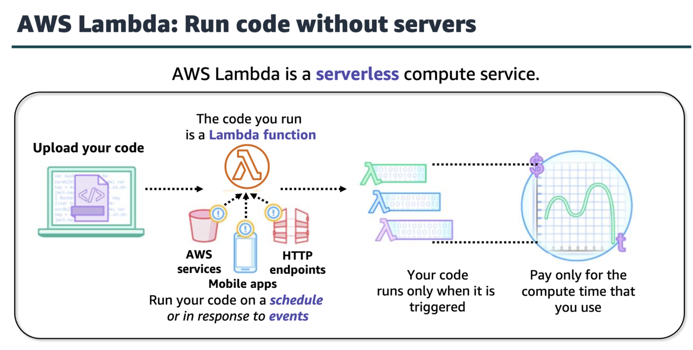

options available inside the launch instance wizard:

ami(amazon machine image)
provides info that is reqd to launch an ec2 instance.

ami includes the following components
template for the root vol
launch permissions
block device mapping

creating a new ami

instance types

u can create an ec2 instance using the aws cli

amazon ec2 instance lifecycle

use amazon cloudwatch to monitor ec2 instance

note: only instances that are backed by amazon ebs can be stopped

four pillars of cost optimization
right size
increase elasticity
optimal pricing model; use on demand instance and spot instances for variable workloads, use reserved instances for predictable workloads
optimize storage choices

section4 is imp, docker and kubernetes

aws lambda

if ur project requires u to run monthly reports that iterate through very large amounts of data, u should consider purchasing scheduled reserved instances.
dedicated instances ensure ur instances will not share a physical host with instances from any other aws customer.
aws lambda is a compute service that lets u run code without provisioning or managing servers.
elastic beanstalk is an aws compute service option. it is a platform as a service that facilitates quick deployment, scaling and managing of ur web applications and services.
reserved instances would be the best ec2 option for long term workloads with predictable usage patterns.
AWS assigns the EC2 instance ID as part of the launch process and the administrator password, which is encrypted via the public key. The instance type defines the virtual hardware and the AMI defines the initial software state. Both must be specified on launch.
