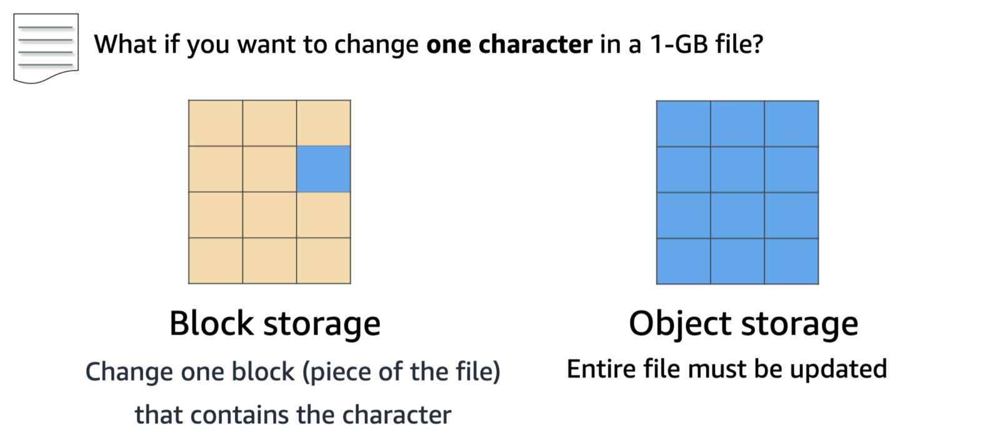
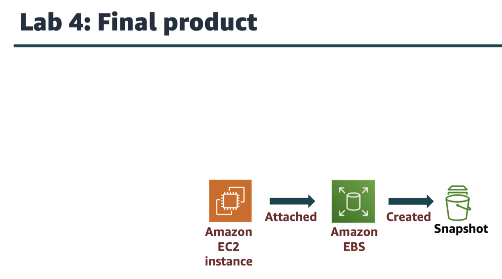
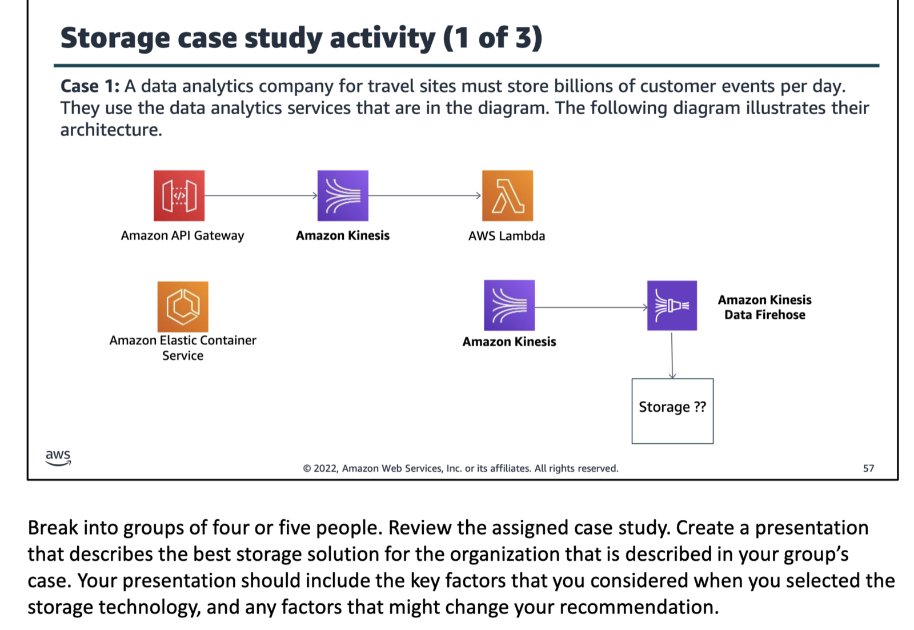
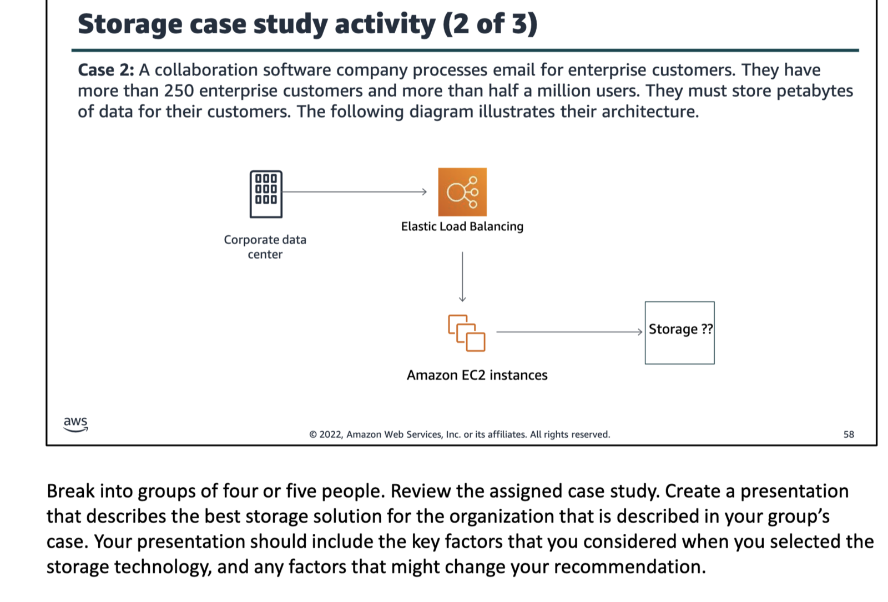
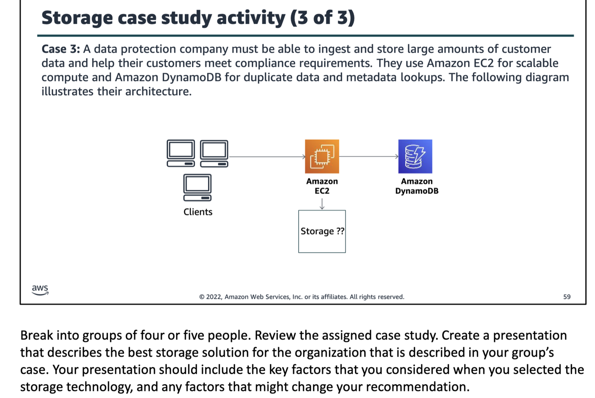

data archiving is the process of moving inactive data to a separate, long term storage system for future use, compliance, or reference.

amazon ebs
provides a persistent block storage(often called non volatile storage) vol for use with amazon ec2 instances. adv: each amazon ebs vol is automatically replicated within its availability zone to protect u from component failure.

block storage vs object storage

block storage solutions are typically faster and use less bandwidth, but they can cost more than object level storage.

iops in aws stands for input/output operations per seconds.

amazon ebs vol persist independently form the running life of an ec2 instance.

- Created an Amazon EBS volume
- Attached the volume to an EC2 instance
- Created a file system on the volume
- Added a file to volume
- Created a snapshot of your volume
- Created a new volume from the snapshot
- Attached and mounted the new volume to your EC2 instance
- Verified that the file you created earlier was on the newly created volume

amazon s3
it is block storage that is built to store and retrieve any amount of data form anywhere, amazon s3 stores data as obj within resources that are called buckets

"11 9s of durability" refers to a very high level of data protection against loss, meaning the storage system is designed to protect against data loss with a probability of just 0.000000001% per object per year

amazon s3 offers a range of object level storage classes
s3 standard
s3 intelligent tiering
s3 standard infrequent access
s3 one zone infrequent access
s3 glacier
s3 glacier deep archive

use cases
As a location for any application data, Amazon S3 buckets provide a shared location for storing objects that any instances of your application can access—including applications on Amazon EC2 or even traditional servers. This feature can be useful for user- generated media files, server logs, or other files that your application must store in a common location. Also, because the content can be fetched directly over the internet, you can offload serving that content from your application and enable clients to directly fetch the data from Amazon S3 themselves.

common scenarios
backup and storage
application hosting
media hosting
software delivery

amazon efs
it implements storage for ec2 instances that multiple virtual machines can access at the same time. it is implemented as a shared file system that uses the network file system(nfs) protocol. it provides simple, scalable, elastic file storage for use with aws services and on premises resources.

semantic web
a proposed development of the World Wide Web in which data in web pages is structured and tagged in such a way that it can be read directly by computers.

mount target: to access ur file system, u must create mount targets in ur vpc. each mount target has the following properties:
mount target id
subnet id for the subnet where it was created
file system id for the file system where it was created
ip addr where the file system can be mounted
mount target state

amazon s3 glacier
it is a secure, durable, and extremely low cost cloud storage service for data archiving and long term backup.
3 key amazon s3 glacier terms:
archive
vault
vault access policy

3 ways to retrieve data
expedited
standard
bulk

using amazon s3 glacier
restful web services
java or .net sdks
amazon s3 with lifecycle policies

we use amazon s3 glacier over amazon s3 when there is less frequent access to data, and also it cost less compared to amazon s3.

glacier, s3 infrequent access and s3 standard access can be used as a storage class for an s3 object lifecycle policy.
u can use efs to implement storage for ec2 instances that multiple virtual machines can access at the same time.
ebs is recommended when data must be quickly accessible, requiring long term persistence and requires an encryption solution.
amazon ebs vol persist when the instance is stopped. the data is automatically replicated within an availability zone, can be encrypted upon creation and used by an instance, as if they were not encrypted.
the vault in amazon glacier is a container for storing archivers.
