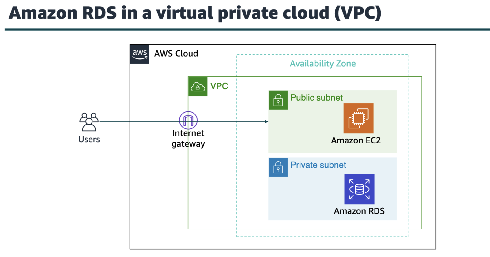
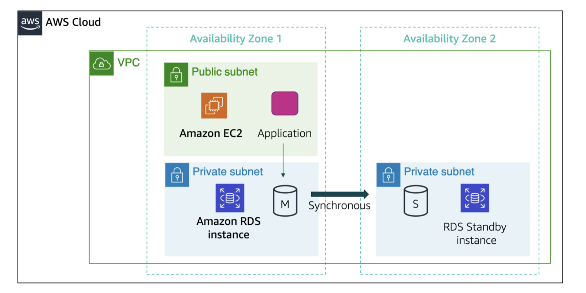
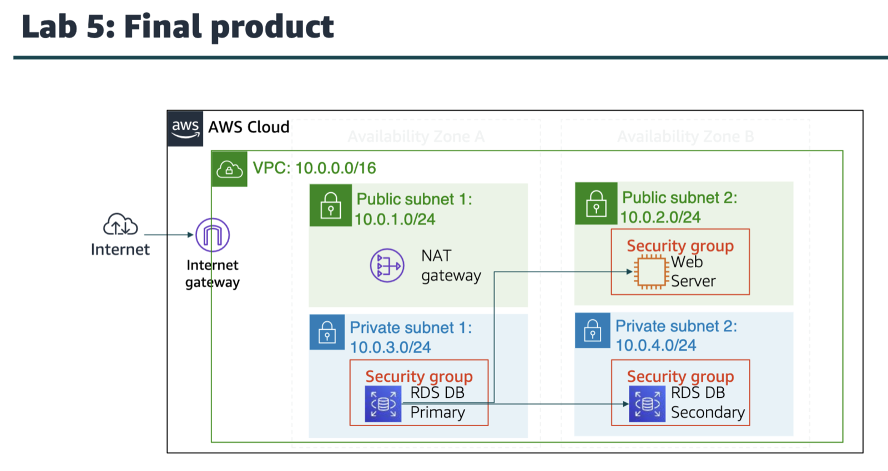
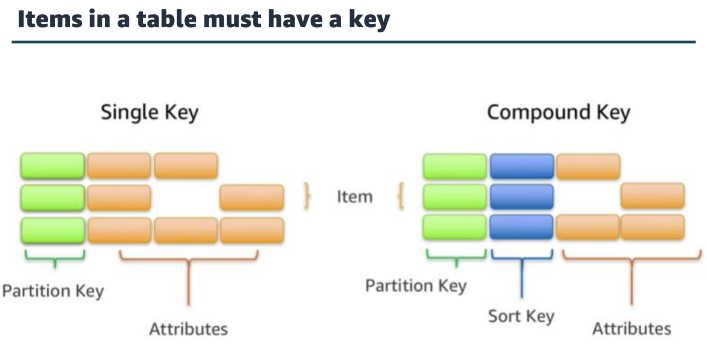
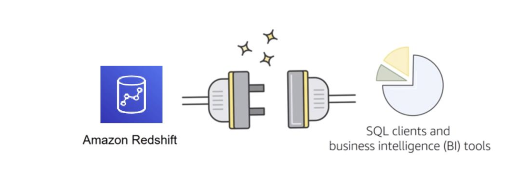
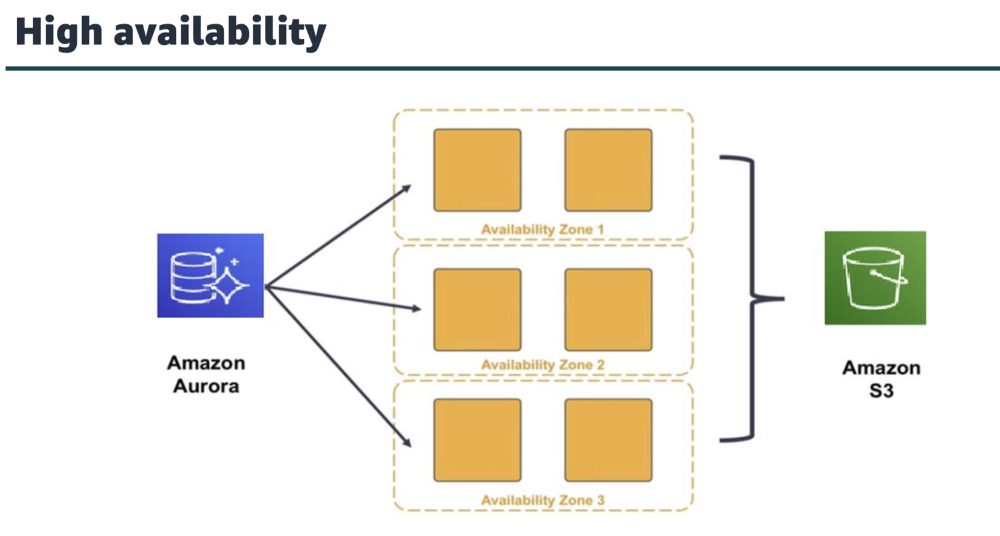
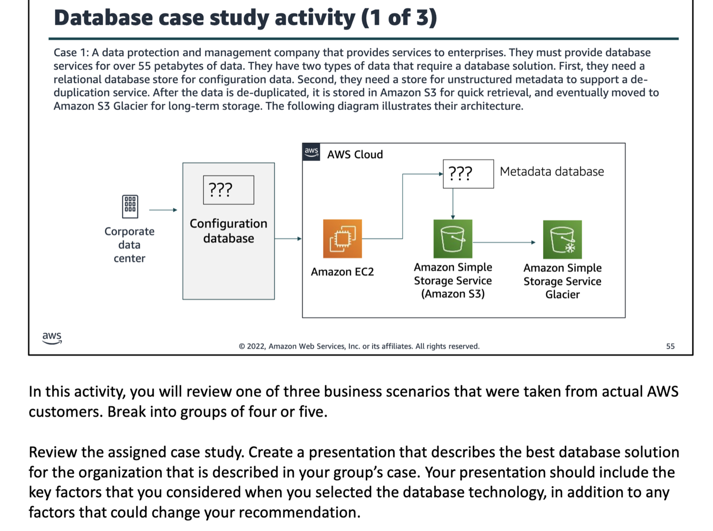
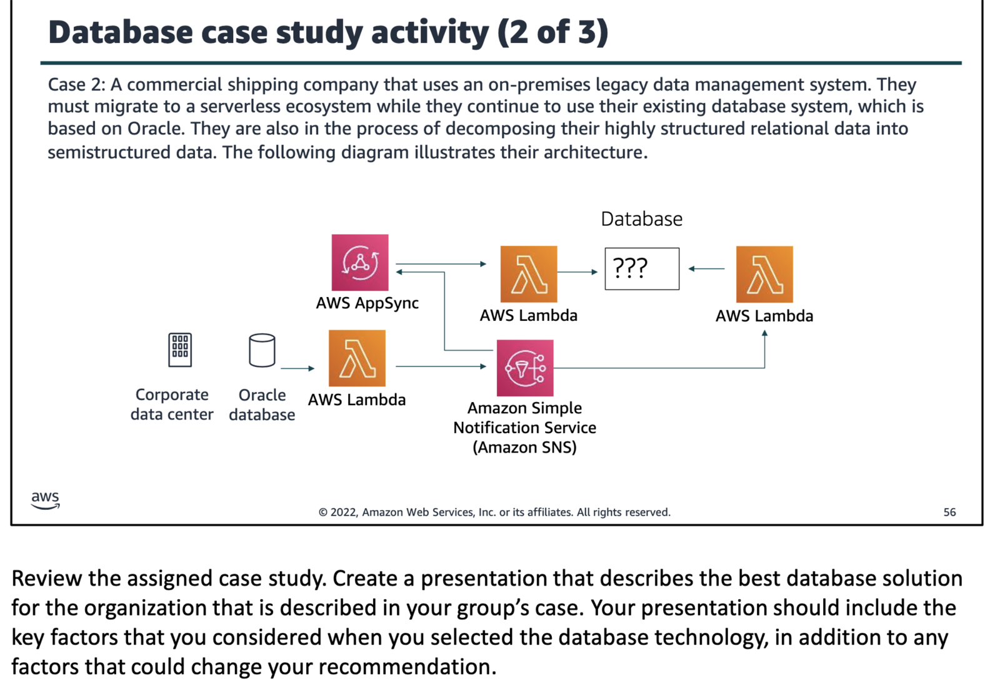
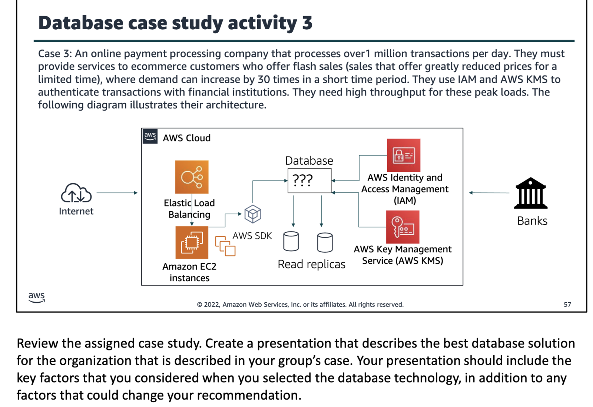

this module will cover
amazon relational database service
amazon dynamodb
amazon redshift
amazon aurora

amazon rds
unmanaged services: scaling, faults tolerance, and availability are managed by u.
managed scaling, fault tolerance, and availability are typically built into the service.

the benefit to using an unmanaged service is that u have more fine tuned control over ur solution that handles changes in load, whereas in managed services its more sort of pre defined that ur challenges would be handled automatically and internally by the service u are using like amazon s3.

challenges of relational database
server maintenance and energy footprint
software installation and patches
database backups and high availability
limits on scalability
data security
os installation and patches

to address the challenges of running an unmanaged, standalone relational database, aws provides a service that sets up, operates, and scales the relational database without any ongoing administration that is amazon rds.

subnets in a vpc are associated with a single availability zone, so when u select the subnet, u are also choosing the availability zone(or physical location) for ur database instance.

multi az deployment

amazon dynamodb
fast and flexible nosql database service for any scale
nosql database tables
virtually unlimited storage
items can have differing attributes
low latency queries
scalable read/write throughput

dynamodb supports two diff kinds of primary keys: partition key and partition and sort key. the partition key is a simple primary key, which is composed of one attribute called the sort key. the partition key and sort key are also known as the composite primary key, which composed of two attributes.

two diff ways to retrieve data from a dynamodb:
the query operation takes advantage of partitioning to effectively locate items by using the primary key.
other method is scan, which enables u to locate items in the table matching conditions on non key attributes, it also gives u the flexibility to locate items by other attributes. however, dynamodb will scan through all the items in the table to find the ones that match ur criteria which makes it inefficient.

amazon redshift
it is a fast, fully managed data warehouse that makes it simple and cost effective to analyze all ur data by using standard sql and ur existing business intelligence(BI) tools.

amazon aurora
enterprise class relational database
compatible with mysql or postgresql
automate time consuming tasks(such as provisioning, patching, backup, recovery, failure detection, and repair).

amazon aurora can use up to 15 read replicas can be used to reduce the possibility of losing ur data. additionally, amazon aurora is designed for instant crash recovery if ur primary database become unhealthy.

brownouts meaning reduction of the supply for electrical power.

after a database crash, amazon aurora does not need to replay the redo log from the last database checkpoint. instead, it performs this on every read operation. this reduces the restart time after a database crash to less than 60 secs in most cases. with amazon aurora, the buffer cache is moved out of the database process, which makes it available immediately at restart. this reduces the need for u to throttle access until the cache is repopulated to avoid brownouts.

nosql databases like amazon dynamodb excel at scaling to hundreds of thousands of requests with key/value access to user profile an session.
amazon redshift is best suited for analyzing data.
in amazon dynamodb, an attribute is a fundamental data element.
if u are developing an application that requires a database with extremely fast performance, fast, scalability, and flexibility in the database schema, consider amazon dynamodb.
use amazon rds when ur application requires complex transactions or complex queries.
