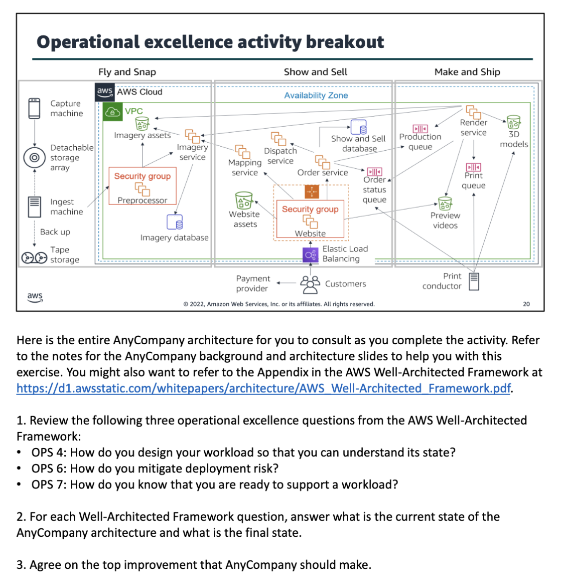
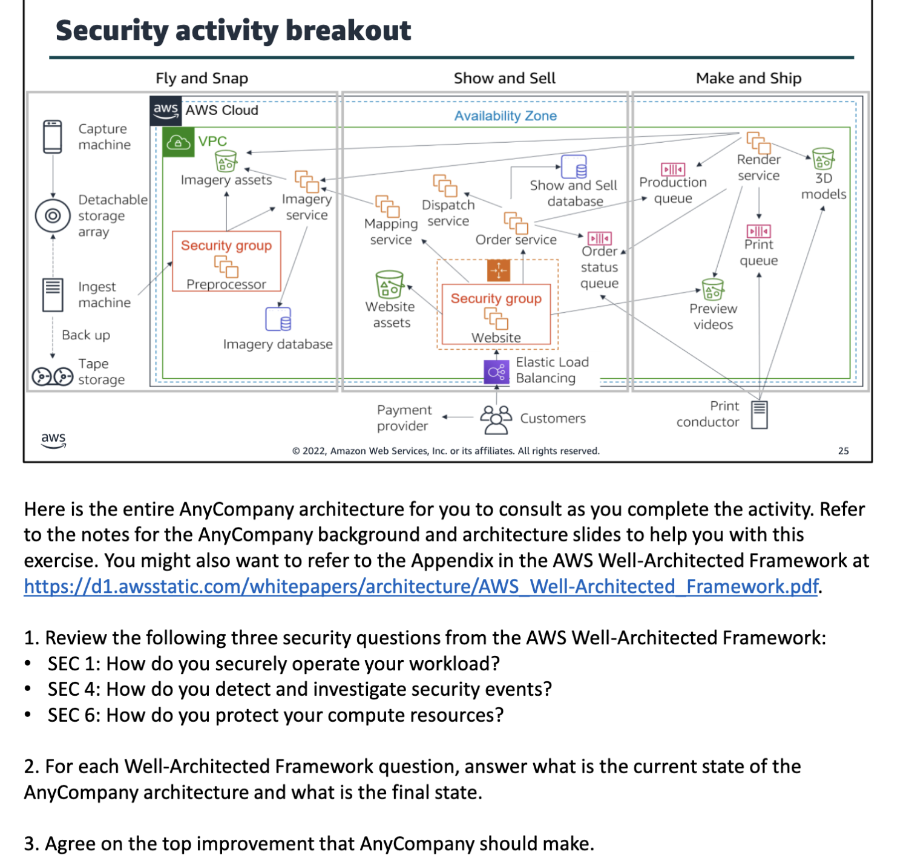
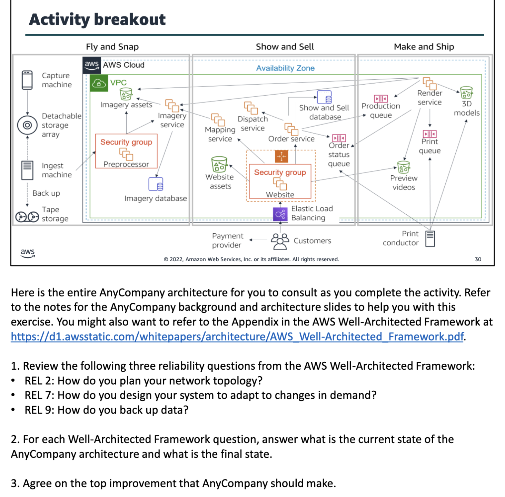
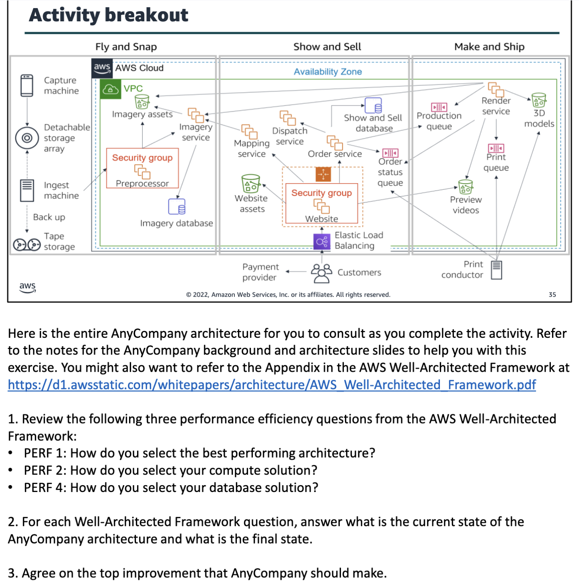
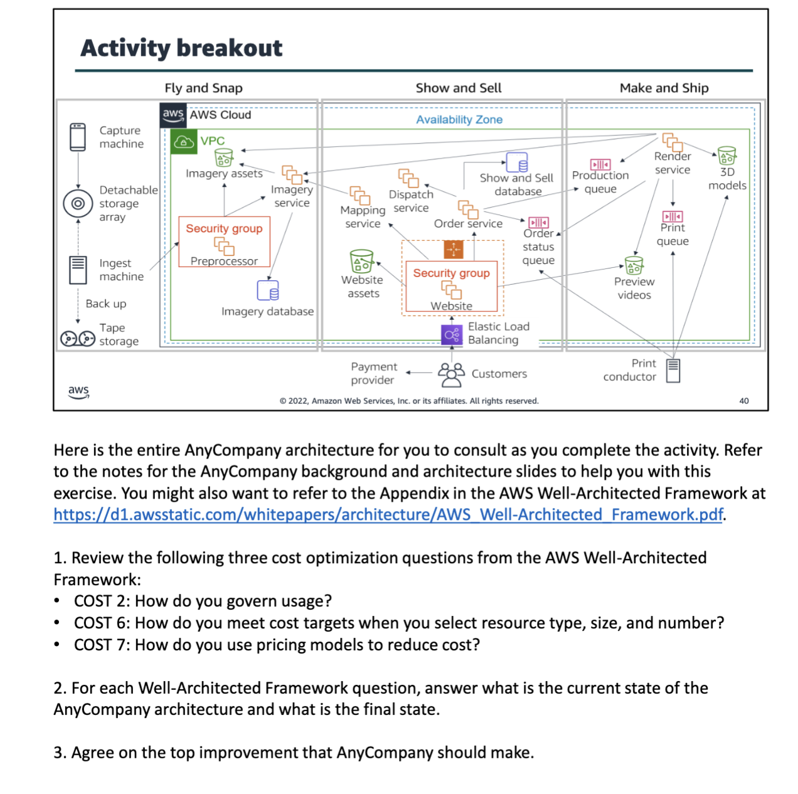

pillars of the aws well architected framework
operational excellence
security
reliability
performance efficiency
cost optimization
sustainability

anycompany corporation has 3 departments
fly and snap
show and sell
make and ship

operational excellence design principles
perform operations as code
make frequent, small, reversible changes
refine operations procedures frequently
anticipate failure
learn from all operational events and failures

security pillar activity
protecting confidentiality and integrity of data
identifying and managing who can do what
protecting systems
establishing controls to detect security events

reliability pillar
designing distributed systems
recovery planning
handling change

reliability design principles
automatically recover from failure
test recovery procedures
scale horizontally to increase aggregate workload availability
stop guessing capacity
manage change in automation

perfomance efficiency pillar
selecting the right resource types and sizes based on workload requirements
monitoring performance
making informed decisions to maintain efficiency as business needs evolve

performance efficiency design principles
democratize advanced technologies
go global in minutes
user serverless architectures
experiment more often
consider mechanical sympathy

cost optimization pillar
understanding and controlling where money is being spent
selecting the most appropriate and right number of resource types
analyzing spend over time
scaling to meeting business needs without overspending

cost optimization design principles
implement cloud financial management
adopt a consumption model
measure overall efficiency
stop spending money on undifferentiated heavy lifting
analyze and attribute expenditure

mean time between failures(mtbf)=total time in service/number of failures

traceability is not one of the four areas of the performance efficiency pillar of the aws well architected framework.
operational excellence, security, and cost optimization are pillars of the aws well architected framework.
performance, cost optimization, security, fault tolerance, and service limits are the five categories regarding which the aws trusted advisor provides insight.
reliability is a measure of ur system ability to provide functionality when desired by the user.
