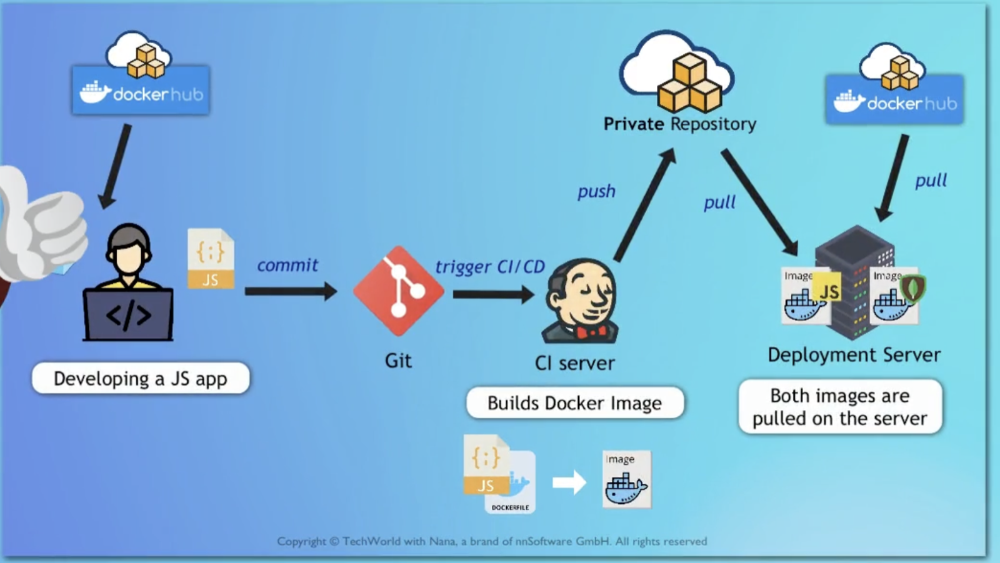
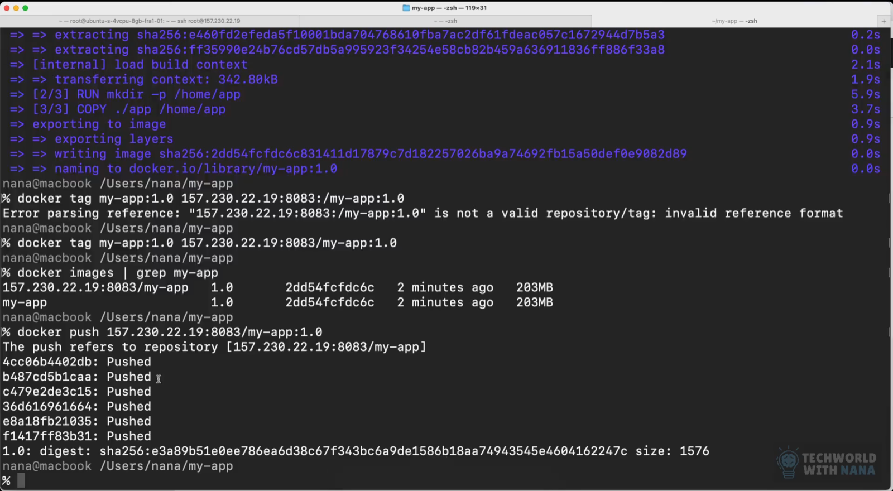
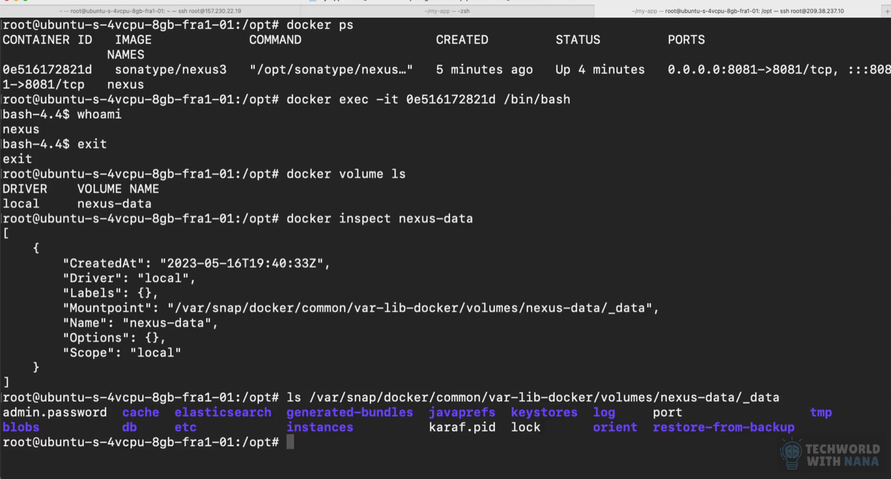

scp source destination:/root

java -jar java-react-example.jar &
run the job in the background

ps aux | grep java

netstat -lpnt

adduser mtrix

usermod -aG sudo mtrix
giving sudo privileges to the user named mtrix

su - mtrix
switch to mtrix user

\# this is used for root user
root@ubuntu1:\~#
$ this is used for other users

```
mtrix@ubuntu1:~$
```

artifacts
apps build into a single file

artifact repository
place where these kinds of artifacts are stored

nexus
artifacts repository manager

features of repository manager
integrate with ldap
flexible and powerful rest api for integration with other tools
backup and restore
multi format support(zip, tar, docker, etc)
metadata tagging(labelling and tagging artifacts)
cleanup policies
search functionality
user token support for system user authentication

tar -zxvf nexus-3.87.1-01-linux-x86_64.tar.gz
chown -R nexus:nexus sonatype-work

.m2

we have 3 diff repo types available as per the use cases
proxy
hosted
group

nexus api to query
curl -u user:passwords -X GET 'http://139.59.86.12:8081/service/rest/v1/repositories'

blob store- file or s3
nexus store all the uploaded files
storage of binary files
local storage or cloud storage



the groupid tag under the project wrapper class in the pom.xml file for java based projects is use to define the group in the repositories they are being stored.

this is how we push image to nexus repository using docker


things to keep in mind while pushing an image to repository hosted on nexus using docker

- create a new repository where u wanted to push or store the docker image.
- select the respective settings blob store, etc and also select the checkbox as docker needs a different port to establish the client connection.(eg 8083)
- create a new user for managing the ‘docker hosted’ repository.
- go to realm tab under the security section in nexus, now add the docker bearer token realm.
- before u perform the next step u need to add the insecure registry setting under ur .docker/daemon.json file.
here is the wrapper that need to be added
"insecure-registries" : \["\<my-registry-ip>:5000"\][https://forums.docker.com/t/how-to-configure-as-insecure-a-registry-running-in-a-container/116166](https://forums.docker.com/t/how-to-configure-as-insecure-a-registry-running-in-a-container/116166)
- create a new docker login credential using the command line eg docker login 157.230.22.19:8083.
- now build the docker image on ur machine.
- give it a new tag for example u can see the above image for ur reference and can follow along.

to access the mountpoint for the nexus registry created using docker, this mount point contains the location where the data is stored for the registry.

