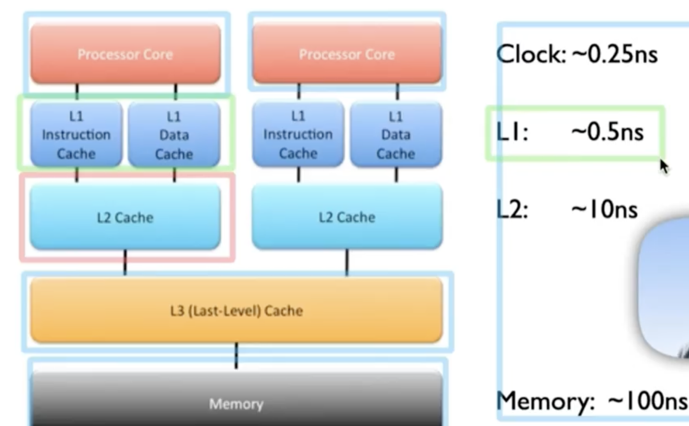
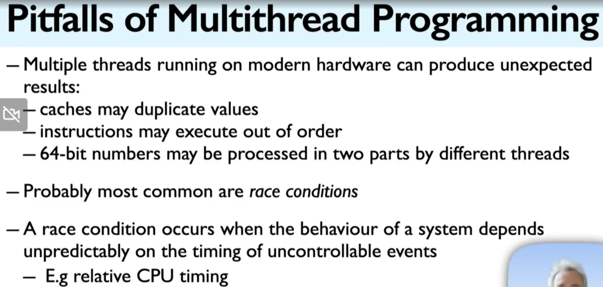
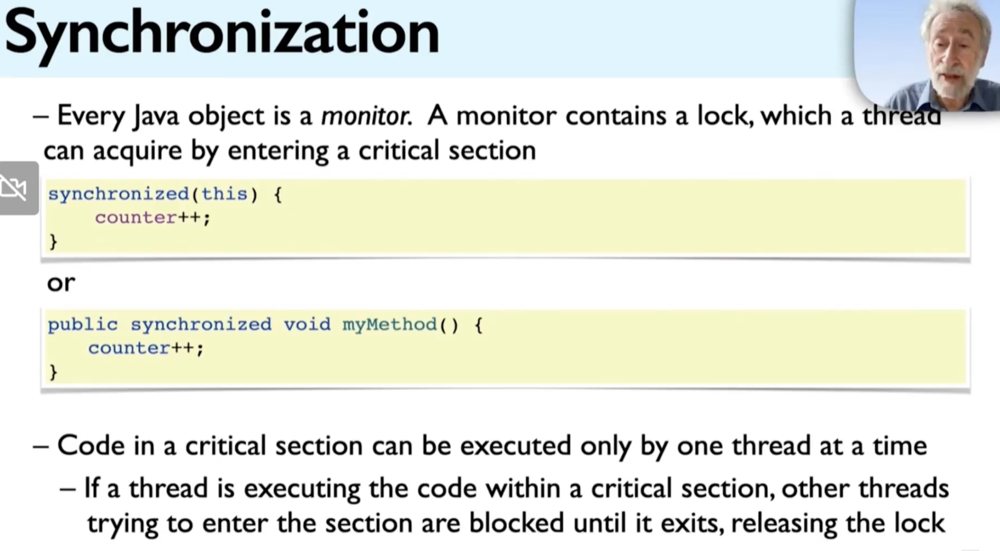

process
insulated from each other; communincation via files, signals, sockets, pipes, etc
no shared memory(by default)

threads are lightweight process
run within a single process, share process resources
in particular, share memory

concurrency-what and why

stale data: data that is not relevant anymore due to lack of updates, unused changes, or broken data pipelines

benefits of threads
gain concurrency benefits within single process
resource utilization, responsive interfaces, design convenience
simplified handling of asynchronous events
divide work of a single process over multiply CPUs

drawbacks of threads
safety; inadequately synchronized code can yield incorrect results
liveness; acquiring locks in the wrong order can deadlock ur program
performance; overhead of thread creation and switching

concurrency
multiple tasks running in overlapping time periods

parallelism
concurrent tasks(typically the same task) running on diff data at the same time, can be defined as the special case of concurrency where multiple task are running at the same time but on diff data

the jmm(java memory model) guarantees that everything done by a thread before it releases a monitor lock is visible to another thread after it has acquired that monitor lock

two imp effects
it prevents threads form interfering with one another in a critical section
it ensures that changes made by one thread are visible to another

we can use atomic variables to endure synchronization and avoid race conditions

Immutability

- immutable obj are always thread safe
- an immutable obj is one whose state graph can’t observably change after const’n
- java obj can be immutable. one way is to define their class such that it- has no mutators, has only private final fields, and has exclusive access to any mutable components
